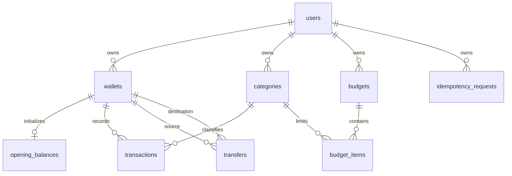

# Thiết kế dữ liệu v1

PostgreSQL 17; backend dự kiến Java 21/Spring Boot modular monolith, frontend Next.js/TypeScript. Migration nằm trong đường dẫn chuẩn Flyway, đã tích hợp Flyway runner qua Spring Boot.

## Quyết định

- Chỉ VND trong MVP: `bigint` đơn vị đồng, giới hạn mỗi khoản dưới 10^15; API tương lai truyền tiền bằng chuỗi thập phân để tránh mất chính xác JavaScript. Tổng dùng `numeric` tránh overflow bigint. Không dùng float.
- Danh mục hệ thống là template do ứng dụng sao chép thành danh mục riêng lúc onboarding; không dùng owner nullable, để FK tổng hợp kiểm soát được quyền sở hữu và loại thu/chi.
- Một số dư khởi tạo/ví, có thể âm. `effective_at` là mốc khởi đầu; service phải từ chối giao dịch trước mốc và không cho thay đổi mốc khi có lịch sử. Quy tắc thời gian và ví archive chưa được DB cưỡng chế.
- Chuyển tiền là một bản ghi gồm nguồn và đích, tránh mất một nửa giao dịch. Chỉnh sửa và soft delete phản ánh ngay qua view, không lưu current_balance độc lập.
- Số dư hiện tại gồm mọi giao dịch chưa xóa; service MVP từ chối ngày tương lai. Báo cáo tháng dùng khoảng thời gian nửa mở `[start, next_start)` theo timezone tài khoản; chuyển ví không tham gia thu/chi.
- Ngân sách duy nhất theo người dùng/tháng, chỉ dùng danh mục EXPENSE. Không giữ số đã chi độc lập.
- Index ưu tiên owner/time, ví, danh mục và hai phía chuyển ví; cần EXPLAIN với dữ liệu beta trước khi tối ưu thêm.

## Ranh giới bảo mật

Composite FK ngăn liên kết dữ liệu hai chủ khác nhau. Đây KHÔNG phải cơ chế bảo vệ đọc dữ liệu: ứng dụng phải lấy owner từ principal đã xác thực, lọc tất cả SELECT/UPDATE/DELETE theo owner, không nhận user_id từ form. Chưa cấu hình RLS; tài khoản DB chỉ cấp cho backend tin cậy, không công khai SQL endpoint hoặc view.

Idempotency: dùng namespace chung `(user_id,key)`, hash request canonical SHA-256, tạo record cùng giao dịch trong một transaction DB. Replay cùng hash trả resource cũ; khác hash trả 409. Không xóa key tự động khi chưa có chính sách retention. Bảng đã có, service/replay/concurrency test chưa triển khai.

Không xóa cascade lịch sử vô tình; xóa tài khoản cần workflow tường minh, thứ tự xóa dependency, revoke session và chính sách backup. Migration V2 đã thêm bảng Spring Session JDBC, identity_tokens, auth_rate_limits và users.auth_version. Feedback/audit chưa triển khai. Không giả lập authentication bằng password hash fixture.

## Đã kiểm thử / còn thiếu

SQL test chạy trên PostgreSQL thật: ví 2.000.000 + thu 5.000.000 − chi 1.500.000 − chuyển 1.000.000 = 4.500.000; tổng hai ví bảo toàn; edit/delete thay số dư; reject cross-owner FK, loại danh mục sai, amount 0, self-transfer, income budget và xóa ví có lịch sử.

Còn cần: kiểm thử HTTP authorization, cạnh tranh/idempotency, budget report theo timezone, archive/date validation, các kiểm thử tài chính cấp HTTP. Authentication đã có integration tests. Migration qua Flyway và chạy lại không thay đổi được kiểm tra bằng integration test. DB constraint không thay thế các kiểm thử này.
